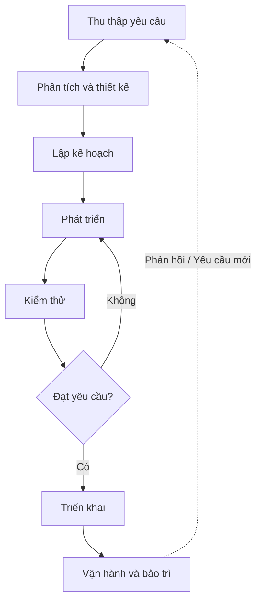
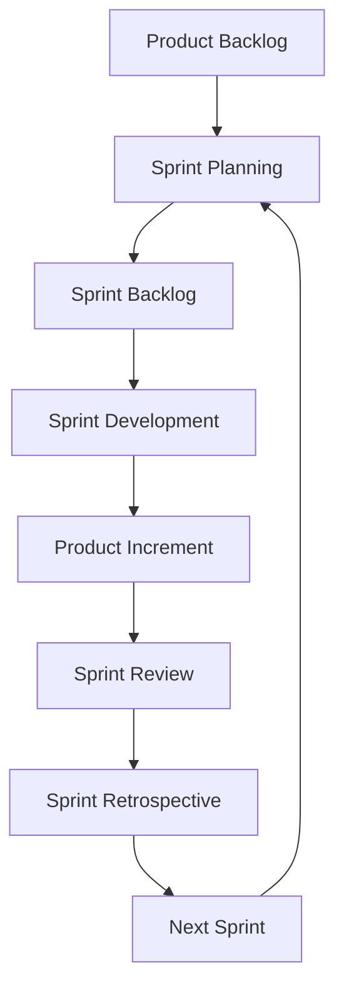
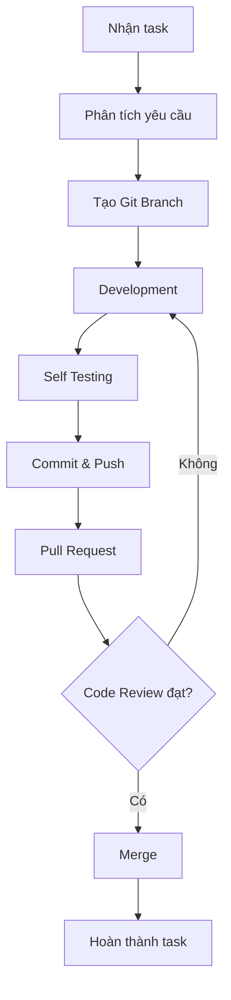
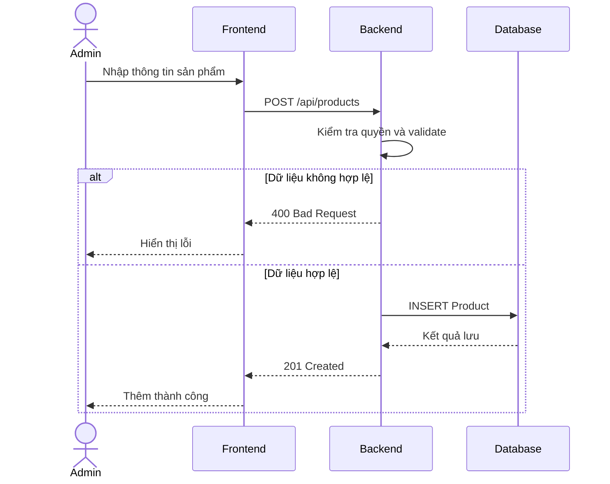

# QUY TRÌNH PHÁT TRIỂN SẢN PHẨM PHẦN MỀM CHUYÊN NGHIỆP

## 1. Tổng quan

### 1.1. Quy trình phát triển phần mềm là gì?

Quy trình phát triển phần mềm (Software Development Life Cycle - SDLC) là tập hợp các giai đoạn và hoạt động được thực hiện để xây dựng, triển khai và duy trì một sản phẩm phần mềm.

Quy trình này giúp các thành viên phối hợp với nhau, đảm bảo sản phẩm đáp ứng yêu cầu của khách hàng và đạt chất lượng mong muốn.

### 1.2. Mục đích

- Đảm bảo sản phẩm đáp ứng yêu cầu nghiệp vụ.
- Quản lý tiến độ và công việc của dự án.
- Giảm thiểu lỗi trong quá trình phát triển.
- Tăng hiệu quả phối hợp giữa các thành viên.
- Kiểm soát chất lượng trước khi triển khai.
- Hỗ trợ bảo trì và nâng cấp sản phẩm.

## 2. Các giai đoạn phát triển sản phẩm

Một quy trình phát triển phần mềm thường gồm 7 giai đoạn chính.

### Giai đoạn 1: Requirement Analysis - Phân tích yêu cầu

Mục tiêu: Xác định sản phẩm cần giải quyết vấn đề gì và khách hàng mong muốn những chức năng nào.

Công việc:
- Thu thập yêu cầu từ khách hàng.
- Phân tích nghiệp vụ.
- Xác định các chức năng cần phát triển.
- Xác định yêu cầu bảo mật, hiệu năng.
- Viết User Story và Acceptance Criteria.

Người tham gia: PO, BA, Tech Lead và các bên liên quan.

Đầu ra:
- Tài liệu yêu cầu phần mềm (SRS).
- Danh sách chức năng.
- User Story.
- Acceptance Criteria.

Ví dụ: Khách hàng muốn xây dựng website bán hàng với các chức năng đăng nhập, quản lý sản phẩm và đặt hàng.

### Giai đoạn 2: System Design - Thiết kế hệ thống

Mục tiêu: Xác định hệ thống được xây dựng như thế nào.

Công việc:
- Thiết kế kiến trúc hệ thống.
- Thiết kế database.
- Thiết kế API.
- Thiết kế giao diện UI/UX.
- Vẽ các sơ đồ mô tả hệ thống.

Người tham gia: Tech Lead, Developer, UI/UX Designer.

Đầu ra:
- Architecture Diagram.
- Database ERD.
- API Specification.
- UI Design.
- Sequence Diagram.

Ví dụ: Sử dụng React cho Frontend, Spring Boot cho Backend và MySQL để lưu dữ liệu.

### Giai đoạn 3: Planning - Lập kế hoạch

Mục tiêu: Phân chia công việc và lên kế hoạch thực hiện.

Công việc:
- Tạo danh sách công việc (Backlog).
- Chia chức năng thành các task.
- Ước lượng độ phức tạp.
- Xác định mức độ ưu tiên.
- Phân công công việc.
- Xác định mục tiêu Sprint nếu sử dụng Scrum.

Người tham gia: PO, Scrum Master, Developers và các vai trò liên quan.

Đầu ra:
- Sprint Backlog hoặc kế hoạch triển khai.
- Danh sách task.
- Mục tiêu và thời hạn dự kiến.

Ví dụ:
- Task 1: Thiết kế bảng Product.
- Task 2: Xây dựng API tạo sản phẩm.
- Task 3: Xây dựng giao diện thêm sản phẩm.
- Task 4: Kiểm thử chức năng.

### Giai đoạn 4: Development - Phát triển

Mục tiêu: Lập trình các chức năng theo yêu cầu đã thống nhất.

Công việc:
- Nhận task từ công cụ quản lý.
- Tạo Git branch riêng.
- Viết source code.
- Viết unit test.
- Kiểm tra code.
- Commit và push.
- Tạo Pull Request hoặc Merge Request.
- Code Review và chỉnh sửa theo feedback.

Người tham gia: Frontend Developer, Backend Developer, Tech Lead.

Đầu ra:
- Source code.
- Unit test.
- Pull Request.
- Tính năng đã hoàn thành.

### Giai đoạn 5: Testing - Kiểm thử

Mục tiêu: Kiểm tra hệ thống hoạt động đúng yêu cầu.

Một số loại kiểm thử:
- Unit Testing: Kiểm tra các đơn vị code nhỏ.
- Integration Testing: Kiểm tra sự kết hợp giữa các module.
- API Testing: Kiểm tra request và response.
- System Testing: Kiểm tra toàn bộ hệ thống.
- Regression Testing: Kiểm tra tính năng cũ sau thay đổi.

Người tham gia: QA/Tester và Developer.

Đầu ra:
- Test Case.
- Test Result.
- Bug Report.

Ví dụ: Khi thêm sản phẩm, QA kiểm tra trường hợp tên rỗng, giá âm và dữ liệu hợp lệ.

### Giai đoạn 6: Deployment - Triển khai

Mục tiêu: Đưa sản phẩm lên môi trường để kiểm thử hoặc sử dụng thực tế.

Công việc:
- Build ứng dụng.
- Chạy CI/CD Pipeline.
- Cấu hình môi trường.
- Triển khai lên server.
- Kiểm tra sau triển khai.

Các môi trường thường gặp:
- Development: Môi trường phát triển.
- Staging: Môi trường kiểm thử trước production.
- Production: Môi trường dành cho người dùng thực tế.

Người tham gia: Developer, DevOps, QA và người phụ trách release.

Đầu ra:
- Phiên bản phần mềm được triển khai.
- Release Notes.
- Deployment Report.

### Giai đoạn 7: Maintenance - Bảo trì

Mục tiêu: Đảm bảo phần mềm hoạt động ổn định sau triển khai.

Công việc:
- Giám sát hệ thống.
- Theo dõi log.
- Xử lý lỗi phát sinh.
- Tối ưu hiệu năng.
- Bổ sung tính năng mới.
- Cập nhật và bảo trì hệ thống.

Người tham gia: Developer, DevOps và đội vận hành.

## 3. Sơ đồ quy trình SDLC bằng Mermaid

Giải thích:
- Bắt đầu từ việc phân tích yêu cầu của khách hàng.
- Thiết kế giải pháp và lập kế hoạch.
- Developer phát triển chức năng.
- QA kiểm thử.
- Nếu chưa đạt yêu cầu thì tiếp tục chỉnh sửa.
- Nếu đạt yêu cầu thì triển khai sản phẩm.
- Sau triển khai, hệ thống tiếp tục được bảo trì và cải tiến.

Lưu ý: Trong thực tế, các hoạt động có thể được thực hiện song song hoặc lặp lại, không nhất thiết theo trình tự cố định.

## 4. Agile và Scrum trong quy trình phát triển

### 4.1. Agile

Agile là tư duy phát triển phần mềm linh hoạt, tập trung vào:
- Phát triển và bàn giao giá trị thường xuyên.
- Phản hồi từ khách hàng.
- Hợp tác giữa các thành viên.
- Thích nghi với thay đổi.

### 4.2. Scrum

Scrum là một framework giúp team phát triển sản phẩm theo từng Sprint.

Sprint thường kéo dài từ 1 đến 4 tuần tùy cách tổ chức của team, và không quá một tháng theo Scrum Guide.

Các hoạt động chính:
- Sprint Planning: Lập kế hoạch Sprint.
- Daily Scrum: Kiểm tra tiến độ hướng tới Sprint Goal.
- Sprint Review: Xem xét kết quả và nhận phản hồi.
- Sprint Retrospective: Đánh giá và cải tiến cách làm việc.

### 4.3. Sơ đồ Scrum

## 5. Quy trình làm việc của Developer trong công ty

Khi được giao một task, Developer thường thực hiện:

1. Nhận task từ mentor, leader hoặc công cụ quản lý công việc.
2. Đọc và phân tích yêu cầu.
3. Trao đổi nếu yêu cầu chưa rõ.
4. Cập nhật branch gốc từ repository.
5. Tạo branch mới cho task.
6. Phát triển chức năng.
7. Tự kiểm tra và chạy test.
8. Commit và push code.
9. Tạo Pull Request.
10. Nhận Code Review.
11. Chỉnh sửa theo feedback.
12. Merge khi đáp ứng các điều kiện của team.
13. Cập nhật trạng thái task.

### Git Workflow Diagram

### Một số quy tắc Git quan trọng

- Không push trực tiếp lên main khi team không cho phép.
- Mỗi task nên có branch phù hợp với quy ước team.
- Commit message cần rõ ràng.
- Kiểm tra code trước khi tạo Pull Request.
- Không commit mật khẩu hoặc secret.
- Không merge khi chưa đáp ứng yêu cầu review và kiểm thử.

## 6. Ví dụ thực tế: Phát triển chức năng thêm sản phẩm

Yêu cầu: Admin có thể thêm sản phẩm mới vào hệ thống.

### Bước 1: Phân tích yêu cầu

Thông tin sản phẩm:
- Tên sản phẩm.
- Giá.
- Mô tả.

Quy tắc:
- Tên không được để trống.
- Giá phải là số không âm.
- Mô tả không bắt buộc.

### Bước 2: Thiết kế

Frontend:
- Tạo form nhập sản phẩm.

Backend:
- API POST /api/products.
- Validate dữ liệu.
- Lưu dữ liệu vào database.

Database:
- Bảng Product.

### Bước 3: Phát triển

Frontend Developer xây dựng giao diện.

Backend Developer tạo API và xử lý nghiệp vụ.

Các developer làm việc trên branch riêng theo phân công.

### Bước 4: Kiểm thử

Kiểm tra:
- Nhập dữ liệu hợp lệ.
- Để trống tên.
- Nhập giá âm.
- Gửi request sai kiểu dữ liệu.
- Kiểm tra quyền tạo sản phẩm.

### Bước 5: Review và triển khai

- Developer tạo Pull Request.
- Reviewer kiểm tra code.
- QA kiểm tra tính năng.
- Team triển khai theo quy trình release.

### Sequence Diagram

## 7. Kết luận

Quy trình phát triển sản phẩm phần mềm chuyên nghiệp bao gồm nhiều hoạt động từ phân tích yêu cầu, thiết kế, lập kế hoạch, phát triển, kiểm thử, triển khai đến bảo trì.

Trong môi trường công ty, Developer không chỉ viết code mà còn cần:
- Hiểu yêu cầu nghiệp vụ.
- Làm việc theo quy trình của team.
- Quản lý source code bằng Git.
- Viết tài liệu kỹ thuật.
- Tự kiểm tra chất lượng code.
- Tham gia Code Review.
- Phối hợp với các thành viên khác.

Việc áp dụng SDLC, Agile/Scrum, Git Workflow và Mermaid giúp quá trình phát triển rõ ràng, dễ quản lý và thuận tiện cho việc bảo trì.

## 8. Tài liệu tham khảo

- Scrum Guide: https://scrumguides.org/scrum-guide.html
- Git Documentation: https://git-scm.com/docs
- GitHub Documentation: https://docs.github.com/
- Mermaid Documentation: https://mermaid.js.org/
- Agile Manifesto: https://agilemanifesto.org/
