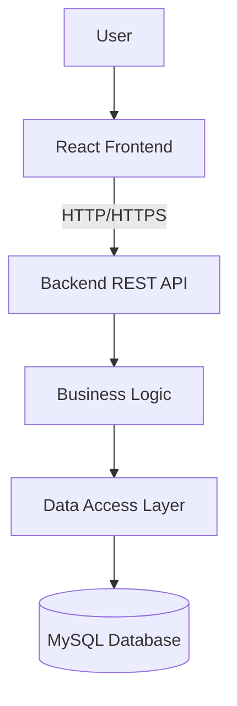
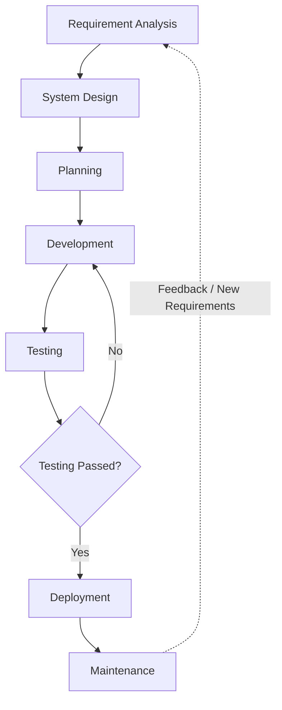
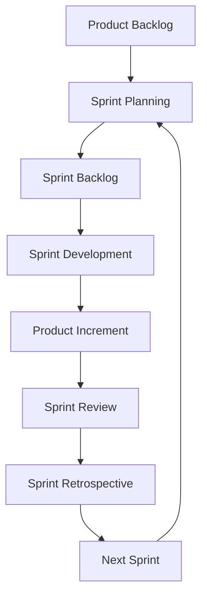
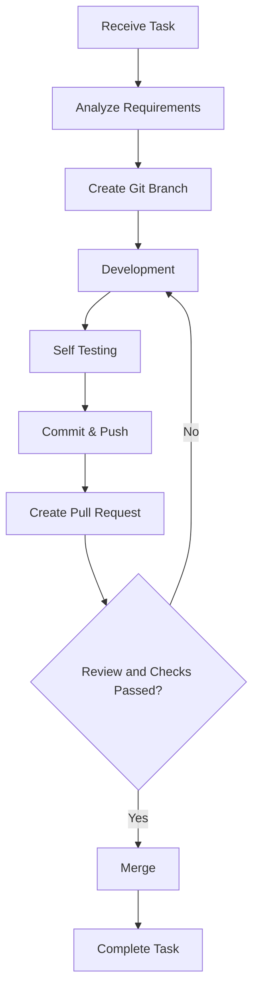
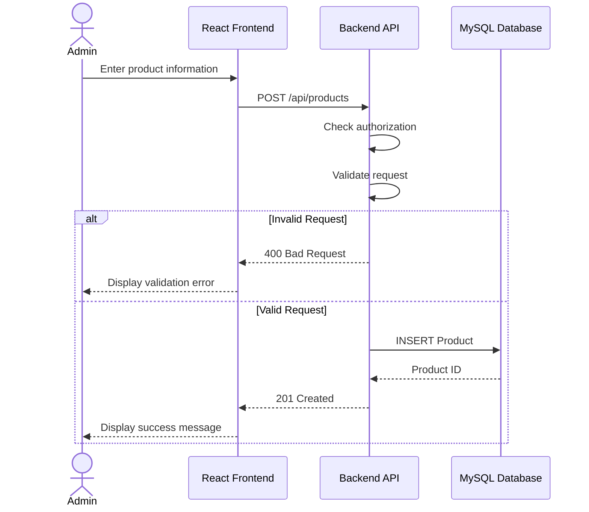

# PROFESSIONAL SOFTWARE DEVELOPMENT PROCESS

## 1. Overview

### 1.1. What is the Software Development Life Cycle (SDLC)?

The Software Development Life Cycle (SDLC) is a structured process used to plan, design, develop, test, deploy, and maintain software products.

SDLC helps development teams collaborate effectively, manage project activities, and ensure that software products meet business requirements and quality standards.

### 1.2. Objectives

The main objectives of SDLC are:

- Ensure the software meets business requirements.
- Improve project planning and management.
- Reduce development risks and software defects.
- Improve collaboration among team members.
- Maintain consistent software quality.
- Support future maintenance and improvements.
- Deliver reliable software products to customers.

## 2. Software Development Life Cycle Phases

A typical software development process consists of seven main phases.

### Phase 1: Requirement Analysis

**Objective:** Understand customer needs and determine the functional and non-functional requirements of the software.

**Main Activities:**
- Collect requirements from stakeholders.
- Analyze business processes.
- Identify system features and functionalities.
- Define functional requirements.
- Define non-functional requirements such as security and performance.
- Create User Stories and Acceptance Criteria.

**Responsible Roles:**
- Product Owner (PO)
- Business Analyst (BA)
- Tech Lead
- Relevant stakeholders

**Deliverables:**
- Software Requirements Specification (SRS)
- Functional Requirements
- Non-functional Requirements
- User Stories
- Acceptance Criteria

**Example:**

A customer requests an e-commerce website with the following features:

- User authentication
- Product management
- Shopping cart
- Order management
- Payment processing

The Business Analyst collects and documents these requirements before development begins.

---

### Phase 2: System Design

**Objective:** Define how the software system will be designed and implemented.

**Main Activities:**
- Design the system architecture.
- Design the database structure.
- Define REST API specifications.
- Design the user interface and user experience.
- Create technical diagrams.
- Select appropriate technologies.

**Responsible Roles:**
- Tech Lead
- Software Architect
- Frontend Developer
- Backend Developer
- UI/UX Designer

**Deliverables:**
- System Architecture Diagram
- Database ERD
- API Specification
- UI/UX Design
- Sequence Diagram

**Example:**

A product management system can use:

- Frontend: React + TypeScript
- Backend: Java Spring Boot
- Database: MySQL
- API Communication: REST API

**System Architecture Diagram:**



---

### Phase 3: Planning

**Objective:** Organize development activities, estimate effort, and assign tasks to team members.

**Main Activities:**
- Create and prioritize the Product Backlog.
- Break features into smaller tasks.
- Estimate task complexity.
- Assign responsibilities.
- Define priorities.
- Plan Sprint goals when using Scrum.
- Identify potential risks and dependencies.

**Responsible Roles:**
- Product Owner
- Scrum Master
- Development Team
- Project Manager, when applicable

**Deliverables:**
- Product Backlog
- Sprint Backlog
- Sprint Goal
- Task List
- Project Timeline

**Example:**

Feature: Product Management

Tasks:
1. Design the Product database table.
2. Implement the Create Product API.
3. Implement the Get Products API.
4. Develop the product management interface.
5. Integrate Frontend and Backend.
6. Write and execute tests.

---

### Phase 4: Development

**Objective:** Implement software features according to the agreed requirements and technical design.

**Main Activities:**
- Receive assigned development tasks.
- Review requirements and acceptance criteria.
- Create a new Git branch.
- Implement Frontend and Backend functionality.
- Write Unit Tests.
- Review code locally.
- Commit and push changes.
- Create a Pull Request or Merge Request.
- Participate in Code Review.
- Fix issues identified during review.

**Responsible Roles:**
- Frontend Developer
- Backend Developer
- Fullstack Developer
- Tech Lead

**Deliverables:**
- Source Code
- Unit Tests
- Pull Requests
- Completed Features
- Build Artifacts

**Example:**

A Backend Developer creates the following API:

POST /api/products

The API validates the request data and stores the new product in the database.

---

### Phase 5: Testing

**Objective:** Verify that the software meets its requirements and identify defects before release.

**Main Activities:**
- Create Test Cases.
- Execute functional tests.
- Test REST APIs.
- Verify database operations.
- Perform regression testing.
- Report and track bugs.
- Verify bug fixes.

**Common Testing Types:**

**Unit Testing**
- Tests individual functions, methods, or components.

**Integration Testing**
- Tests interactions between multiple modules or services.

**API Testing**
- Verifies API requests, responses, and HTTP status codes.

**System Testing**
- Validates the complete system against requirements.

**Regression Testing**
- Ensures that new changes do not break existing functionality.

**End-to-End Testing**
- Tests complete user workflows.

**Responsible Roles:**
- QA Engineer
- Software Tester
- Developer

**Deliverables:**
- Test Cases
- Test Results
- Bug Reports
- Quality Reports

**Example:**

For the Create Product API, testers verify the following cases:

| Test Case | Input | Expected Result |
|---|---|---|
| TC01 | Valid product data | 201 Created |
| TC02 | Empty product name | 400 Bad Request |
| TC03 | Negative price | 400 Bad Request |
| TC04 | Invalid price type | 400 Bad Request |
| TC05 | Unauthorized user | 401 or 403, depending on the authentication state |

---

### Phase 6: Deployment

**Objective:** Release the tested software to a target environment where it can be used.

**Main Activities:**
- Build the application.
- Run CI/CD pipelines.
- Configure environment variables.
- Prepare infrastructure.
- Apply database migrations when required.
- Deploy the application.
- Perform post-deployment verification.
- Monitor deployment status.

**Common Environments:**

**Development**
- Used by developers to implement and test features.

**Staging**
- Used to validate changes before production deployment.

**Production**
- Used by actual customers and end users.

**Responsible Roles:**
- DevOps Engineer
- Developer
- QA Engineer
- Release Manager, when applicable

**Deliverables:**
- Deployed Application
- Release Notes
- Deployment Logs
- Release Version

---

### Phase 7: Maintenance

**Objective:** Ensure that the software remains stable, secure, and reliable after deployment.

**Main Activities:**
- Monitor application performance.
- Analyze application logs.
- Fix production bugs.
- Improve system performance.
- Update dependencies.
- Add new features.
- Perform backups and recovery activities.
- Respond to operational incidents.

**Responsible Roles:**
- Developers
- DevOps Engineers
- Operations Team
- Support Team

**Deliverables:**
- Bug Fixes
- Maintenance Updates
- Monitoring Reports
- New Feature Releases

## 3. SDLC Workflow Diagram

The following Mermaid diagram illustrates a typical software development workflow.



### Explanation

1. The team collects and analyzes customer requirements.
2. Developers and architects design the system.
3. The team creates a development plan.
4. Developers implement the features.
5. Testers verify the software.
6. If testing fails, the issues are returned to development.
7. If testing passes and the release is approved, the software is deployed.
8. The team monitors and maintains the application.
9. New feedback may start another development cycle.

**Note:** In real projects, these activities may overlap or repeat. They do not always follow a strictly sequential process.

## 4. Agile and Scrum

### 4.1. What is Agile?

Agile is a set of values and principles for developing software through collaboration, continuous feedback, and adaptation to change.

**Key Characteristics:**
- Iterative and incremental development.
- Frequent delivery of valuable software.
- Continuous customer feedback.
- Team collaboration.
- Flexibility when requirements change.
- Continuous improvement.

### 4.2. What is Scrum?

Scrum is a lightweight framework that helps teams organize and manage complex work.

Scrum divides development into fixed-length iterations called Sprints.

A Sprint lasts no longer than one month. Teams commonly choose a duration such as one or two weeks.

### 4.3. Main Scrum Events

**Sprint Planning**
- Define the Sprint Goal.
- Select Product Backlog Items.
- Plan how to complete the selected work.

**Daily Scrum**
- A 15-minute event for Developers.
- Inspect progress toward the Sprint Goal.
- Adapt the plan for upcoming work.

**Sprint Review**
- Review the Sprint results with stakeholders.
- Discuss feedback and future adjustments.

**Sprint Retrospective**
- Evaluate the team's working process.
- Identify opportunities for improvement.

### 4.4. Scrum Roles

**Product Owner**
- Maximizes product value.
- Manages and prioritizes the Product Backlog.

**Scrum Master**
- Helps the team understand and apply Scrum.
- Supports the removal of impediments.

**Developers**
- Plan and implement work.
- Maintain software quality.
- Create usable product increments.

### 4.5. Scrum Workflow Diagram



### 4.6. Agile vs. Scrum

| Criteria | Agile | Scrum |
|---|---|---|
| Definition | Values and principles | Framework |
| Focus | Flexibility and collaboration | Iterative product delivery |
| Sprint | Not required | Required |
| Defined Roles | No fixed roles | PO, Scrum Master, Developers |
| Daily Scrum | Not required | Required |

Scrum is one way of applying Agile principles.

## 5. Professional Developer Workflow

In a professional software development team, developers follow an organized workflow instead of directly modifying the main source code.

### 5.1. Typical Developer Workflow

1. Receive a task from the mentor, team leader, or project management tool.
2. Read the task description.
3. Understand the requirements and acceptance criteria.
4. Clarify unclear requirements.
5. Update the local repository.
6. Create a new Git branch.
7. Implement the feature.
8. Run tests and review the changes.
9. Commit changes with a meaningful message.
10. Push the branch to the remote repository.
11. Create a Pull Request.
12. Participate in Code Review.
13. Address review comments.
14. Merge after all required approvals and checks pass.
15. Update the task status.

### 5.2. Git Workflow Diagram



### 5.3. Common Git Branches

| Branch | Purpose |
|---|---|
| main | Main or stable branch |
| develop | Integration branch in some workflows |
| feature/* | New feature development |
| fix/* | Bug fixes |
| docs/* | Documentation updates |
| hotfix/* | Urgent fixes in certain workflows |

The exact branching strategy depends on the team's development process.

### 5.4. Common Git Commands

Check repository status:

```bash
git status
```

List branches:

```bash
git branch -a
```

Switch to the main branch:

```bash
git switch main
```

Update the main branch:

```bash
git pull --ff-only origin main
```

Create a new documentation branch:

```bash
git switch -c docs/software-development-process
```

Stage changes:

```bash
git add docs/
```

Commit changes:

```bash
git commit -m "docs: add software development process documentation"
```

Push the branch:

```bash
git push -u origin docs/software-development-process
```

### 5.5. Pull Request and Code Review

A Pull Request (PR) is a request to integrate changes from one branch into another.

**Benefits:**
- Review source code before merging.
- Detect potential bugs.
- Improve code readability.
- Share technical knowledge.
- Verify that required tests pass.
- Maintain code quality.

**Typical Code Review Process:**

1. Developer completes the implementation.
2. Developer creates a Pull Request.
3. Reviewer examines the changes.
4. Reviewer provides feedback.
5. Developer fixes identified issues.
6. Automated checks are executed.
7. Reviewer approves the Pull Request.
8. Changes are merged according to team rules.

### 5.6. Git Best Practices

- Do not push directly to protected branches.
- Use meaningful branch names.
- Write clear commit messages.
- Keep changes focused on the assigned task.
- Review changes before committing.
- Never commit passwords, tokens, or secrets.
- Do not merge code without required approvals.
- Resolve merge conflicts carefully.
- Ensure required tests and CI checks pass.

## 6. Practical Example: Create Product Feature

This section demonstrates how a feature is developed using a professional software development process.

### Step 1: Requirement Analysis

**Business Requirement:**

An administrator needs to create new products in the product management system.

**Functional Requirements:**
- Enter a product name.
- Enter a product price.
- Enter an optional description.
- Submit the product information.
- Store the product in the database.

**Validation Rules:**
- Product name must not be empty.
- Product price must be a non-negative number.
- Description is optional.

### Step 2: System Design

**Frontend**
- Create a product form.
- Validate form inputs.
- Send requests to the Backend API.
- Display success and error messages.

**Backend**
- Implement POST /api/products.
- Validate request data.
- Check authentication and authorization.
- Process business logic.
- Save product data.

**Database**
- Create the Product table.
- Store product information.

### Step 3: Development Planning

Example tasks:

- Task 1: Design the Product entity.
- Task 2: Create the Product database table.
- Task 3: Implement the Create Product API.
- Task 4: Develop the Create Product form.
- Task 5: Integrate Frontend and Backend.
- Task 6: Write tests.

### Step 4: Development

The Backend Developer implements the REST API.

The Frontend Developer creates the user interface and integrates the API.

Developers work on separate branches according to the team's Git workflow.

### Step 5: Testing

Test the following scenarios:

- Create a product with valid information.
- Submit an empty product name.
- Submit a negative product price.
- Submit an invalid price data type.
- Submit a request without sufficient permissions.

### Step 6: Code Review and Deployment

- Developers create Pull Requests.
- Reviewers verify the implementation.
- Developers address feedback.
- Automated tests and required checks run.
- Approved changes are merged.
- The feature is deployed according to the release process.

### Step 7: Maintenance

After deployment, the team:
- Monitors application logs.
- Fixes reported issues.
- Improves performance.
- Implements future enhancements.

## 7. Product Creation Sequence Diagram



### Diagram Explanation

1. The administrator enters product information.
2. React sends a POST request to the Backend API.
3. The backend checks permissions and validates the request.
4. If the data is invalid, an error response is returned.
5. If the data is valid, the backend stores the product in MySQL.
6. The backend returns HTTP 201 Created.
7. The frontend displays a success message.

## 8. Conclusion

The professional software development process includes multiple activities, from requirement analysis and system design to implementation, testing, deployment, and maintenance.

A professional Software Developer should not only know how to write code but also understand:

- Business requirements.
- Software architecture and design.
- Agile and Scrum.
- Team collaboration.
- Git branching strategies.
- Pull Requests and Code Review.
- Software testing.
- CI/CD and deployment.
- Application monitoring and maintenance.

Understanding SDLC and applying professional development practices help teams deliver reliable, maintainable, and scalable software products.

Mermaid diagrams also make technical documentation easier to understand, review, and maintain.

## 9. References

1. Scrum Guide  
   https://scrumguides.org/scrum-guide.html

2. Git Documentation  
   https://git-scm.com/docs

3. GitHub Documentation  
   https://docs.github.com/

4. Mermaid Documentation  
   https://mermaid.js.org/

5. Agile Manifesto  
   https://agilemanifesto.org/
